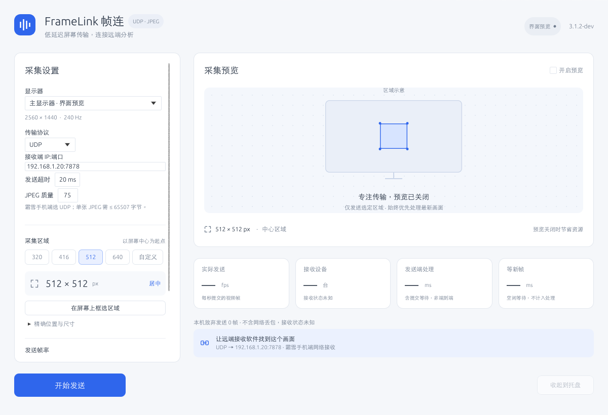
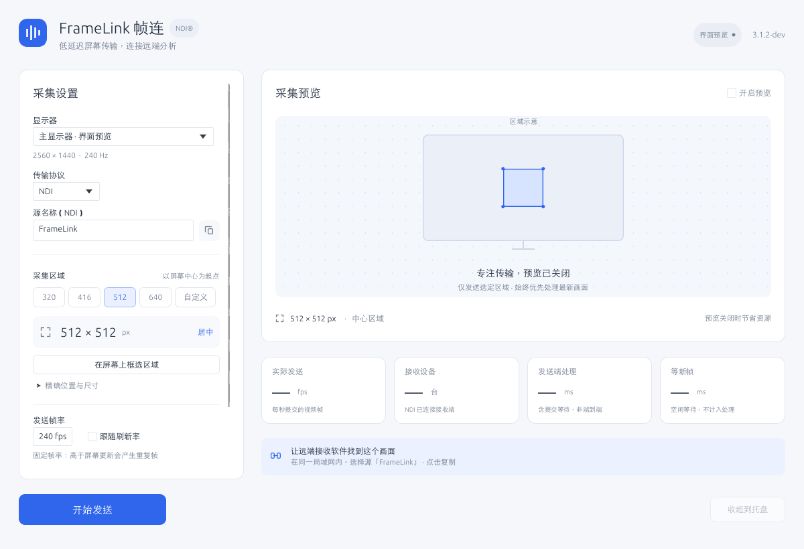

# FrameLink 帧连

Windows 10 / 11 x64 屏幕区域推流工具，支持 **NDI、TCP 和 UDP**。NDI 可对接 AimRust；TCP / UDP 按霜雪 7.18 手机副机端的 JPEG 接收协议实现。


截图由实际 egui 控件离屏渲染，使用示例地址；不表示已连接手机或测得运行性能。

当前版本：`3.1.2-dev`。仅发布 Windows x64 应用，颜色转换使用 libyuv SIMD。默认 512×512、240 fps、NV12；240 是请求的发送帧率，实际更新数和端到端吞吐需实测。

## 使用

解压构建包，启动 `FrameLink.exe`。仅 NDI 模式需要同目录的 `Processing.NDI.Lib.x64.dll`，其运行可能需要 Microsoft Visual C++ 2015–2022 x64 运行库；TCP / UDP 无需 NDI DLL。请保留分发包中的许可证。

| 协议 | 接收端 | 视频格式 |
| --- | --- | --- |
| NDI（默认） | AimRust 等 NDI 接收软件 | NV12 / BGRX 交给 NDI SDK |
| TCP | 霜雪手机端的 TCP 网络接收 | 连续 JPEG 图片 |
| UDP | 霜雪手机端的 UDP 网络接收 | 一包一张 JPEG，上限 65,507 字节 |

1. 选择显示器、采集区域和传输协议。NDI 填源名称；TCP / UDP 填手机的 IP 和监听端口。
2. 手机端先选择相同协议并启动网络接收；使用 NDI 时，在 AimRust 中刷新并选择 `电脑名 (FrameLink)`。
3. 点击“开始发送”。默认请求 240 fps，关闭鼠标和预览。Windows 防火墙需允许相应的专用网络通信。

“自动选择”优先使用 DXGI；可手动选择 DXGI 或 GDI。DXGI 区域需位于单个非旋转显示器内；跨屏或旋转显示器可使用固定帧率 GDI。中心 512 / 640、手动坐标和桌面框选均保留。固定帧率可能重复发送上一张画面；“跟随刷新率”只发送实际桌面更新，不补帧。

NDI 模式下，多网卡电脑可在“发送网卡”选择有线网卡，点击“应用并重启”后再发送。“自动选择”沿用原有 NDI 配置。选择会记住网卡本身并在启动时读取当前 IP；指定网卡不保证降低延迟。

发送时可切换预览；调整采集参数需先停止。关闭窗口默认收到托盘并继续发送，双击托盘图标恢复，右键可停止或退出。再次启动程序会恢复已有窗口，保留原发送任务和设置。

设置保存在 `%LOCALAPPDATA%\FrameLink\settings.toml`，编辑后自动保存。首次启动可导入 `%LOCALAPPDATA%\ScreenCastSendRust\settings.toml` 或 `%LOCALAPPDATA%\ScreenCastSendCpp\settings.ini`，不会删除原配置。

程序只发送 SDR 8 位视频，不发送音频。界面“发送端处理”统计采集拷贝、转换 / JPEG 编码和所选传输提交的平均调用耗时，“等新帧”单独显示。提交可能包含网络背压等待；两者均不能代表完整网络、解码和 AimRust 推理延迟；Full NDI 也不能保证逐像素数学无损。

## TCP / UDP 手机接收

在霜雪手机端选择网络画面、TCP 或 UDP 并启动接收；FrameLink 选择相同协议，填写 `手机IP:端口`（APK 默认端口 `7878`，以手机设置为准），再开始发送。TCP / UDP 无需 NDI DLL。NDI 保持默认，旧配置兼容。

- TCP：连续 JPEG 图片，无额外帧头，发送超时后停止连接，可重新开始。
- UDP：一包一张完整 JPEG，不重传；单张上限 65,507 字节。超限时降低 JPEG 质量 / 尺寸或使用 TCP，不做 APK 无法识别的应用层分片。
- JPEG 质量默认 75，可调 1–100。复用像素与编码输出缓冲，静止画面不重复编码；Windows x64 支持 AVX2 时使用 SIMD 编码。
- 不增加应用层帧队列；默认发送预算 20 ms。TCP / UDP 使用系统路由，NDI 网卡选择只影响 NDI。

兼容性已按所提供 APK 的静态代码和本机协议测试核对，仍需 Windows → 手机实测；240 fps 的实际接收和推理吞吐尚未保证。协议、APK 依据、接收示例、性能基准及验收方法见[传输协议](docs/传输协议.md)。

<details>
<summary>查看 UDP 和 NDI 界面</summary>





</details>

## 构建 Windows 包

需要 Rust 1.88+、Python 3 和 Visual Studio 2022 C++ Build Tools / Windows SDK。编译无需 NDI SDK；完整分发包包含 NDI 运行库，应用只在 NDI 模式加载它。仓库包含 libyuv 源码、图标资源与许可证，不提交运行库二进制或发布包。

将官方 NDI Windows x64 重分发包中的 DLL 和两份许可证放在同一个目录，然后运行：

```powershell
rustup target add x86_64-pc-windows-msvc
python tools/build_rust.py --target x86_64-pc-windows-msvc --ndi-runtime C:\NDI\Processing.NDI.Lib.x64.dll
```

未指定 `--ndi-runtime` 时读取项目根目录 DLL。运行库旁必须有 `NDI License Agreement.pdf` 和 `Processing.NDI.Lib.Licenses.txt`。可用 `--ndi-source-manifest` 一并保留下载来源记录；打包器校验 EXE / DLL 的 x64 PE 格式，并记录二者 SHA-256。输出 `dist/FrameLink-3.1.2-dev-Windows-x64.zip`。已有 Release 结果时，可加 `--skip-build`；使用 `--output-dir dist/tcp-udp` 可输出到独立目录。

非 Windows 开发主机可交叉编译 Windows GNU 目标，需要 MinGW-w64 的 `x86_64-w64-mingw32-g++` 和 `x86_64-w64-mingw32-windres`：

```sh
rustup target add x86_64-pc-windows-gnu
python3 tools/build_rust.py --target x86_64-pc-windows-gnu --ndi-runtime /path/to/Processing.NDI.Lib.x64.dll
```

Windows GNU 本机构建同样需要完整 MinGW-w64，包括编译器自身依赖的 DLL。发布 EXE 静态链接 libstdc++，NDI 仍为独立 DLL。交叉编译不能验证 Windows 采集、GPU 或网络运行效果。

## 开发与验证

Windows 开发机：

```powershell
cargo fmt --all -- --check
cargo test --locked --all-targets
cargo clippy --locked --all-targets -- -D warnings
cargo build --locked --release --bin FrameLink
cargo run --locked --bin FrameLink -- --ui-snapshot docs/ui
```

非 Windows 主机可运行共享逻辑测试 `cargo test --locked --lib` 和开发示例，或使用明确的 Windows `--target` 检查/构建；不生成本机桌面应用。CI 在 Windows 上检查格式、Clippy、单测和 Release 构建。

无需 Windows 桌面即可生成 NDI / TCP / UDP 的 1200 和 960 像素界面截图（不会启动采集或改写用户设置）：

```sh
cargo run --locked --example ui_snapshot -- docs/ui
```

Windows 解压目录内可检查运行库或采集处理耗时：

```powershell
Start-Process .\FrameLink.exe -ArgumentList '--check-ndi' -RedirectStandardOutput ndi-check.json -Wait
Start-Process .\FrameLink.exe -ArgumentList '--benchmark-pixels','2' -RedirectStandardOutput pixels.json -Wait
Start-Process .\FrameLink.exe -ArgumentList '--measure-send','10','sender-report.json' -Wait
```

发送诊断前在 GUI 保存配置并退出，保持接收软件运行，在采样期间显示持续运动画面。报告包含采集、Map 等待、转换 / JPEG 编码、传输提交调用分位数和提交前后帧龄；它不是完整的双机延迟。Windows 实机采集、NDI 发流、240 fps 稳态和与 AimRust 的链路吞吐尚需验收。模块与完整步骤见[开发说明](docs/开发说明.md)。

NDI® is a registered trademark of Vizrt NDI AB. See [NDI](https://ndi.video/), [NDI 许可协议](<NDI License Agreement.pdf>) and [依赖许可](Processing.NDI.Lib.Licenses.txt). libyuv 与 Rust 依赖许可由打包脚本一并收集。
