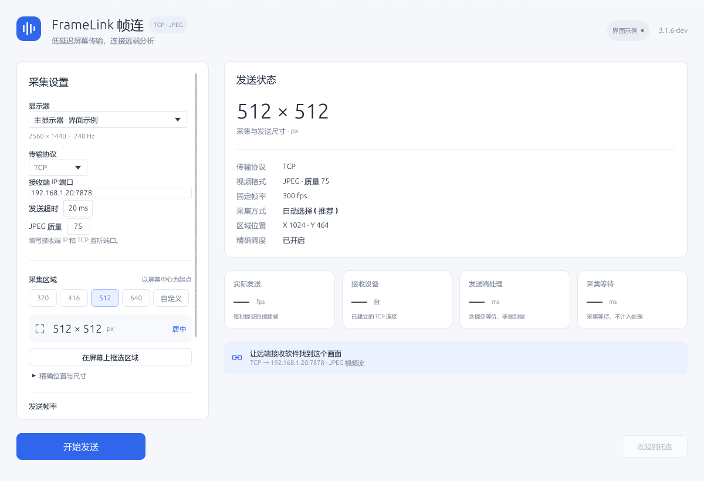

# FrameLink 帧连

FrameLink 是一款 Windows 屏幕区域推流应用，可通过 NDI、TCP 或 UDP 将指定区域的画面发送到局域网内的接收端。

[下载 Windows x64](https://github.com/AriseFX/FrameLink/releases) · [使用说明](docs/使用说明.md) · [问题反馈](https://github.com/AriseFX/FrameLink/issues)



## 功能

- **区域采集**：支持多显示器、桌面框选、手动坐标和中心 320 / 416 / 512 / 640 方形预设。
- **三种传输方式**：NDI 支持 NV12 / BGRX 输入；TCP、UDP 使用 JPEG，可调整压缩质量。
- **采集与帧率设置**：支持 DXGI、GDI，可直接填写 1–1000 fps 固定发送帧率。
- **可选 GPU 转换**：DXGI 可在显卡上将原尺寸画面转换为 NV12，减少回读数据量；实验性功能，默认关闭。
- **发送控制**：可选鼠标显示和 NDI 发送网卡。
- **后台运行**：关闭窗口后可继续在托盘发送；再次启动会恢复已有窗口，设置自动保存。

## 下载与运行

支持 **Windows 10 / 11 x64**。

1. 在 [Releases](https://github.com/AriseFX/FrameLink/releases) 下载 `FrameLink-版本号-Windows-x64.zip`。
2. 解压整个压缩包，运行 `FrameLink.exe`。升级前先退出旧版。
3. 如提示缺少 `VCRUNTIME140.dll`，安装 Microsoft Visual C++ 2015–2022 x64 运行库。

发布包已包含 NDI 运行库，使用 NDI 时请保留同目录的 `Processing.NDI.Lib.x64.dll`。标为 Pre-release 的版本是开发测试版。

## 快速开始

1. 选择显示器和采集区域。
2. 选择传输协议并配置接收端：

   | 协议 | 设置方式 |
   | --- | --- |
   | NDI | 填写源名称，发送后在接收端选择 `电脑名 (源名称)`。 |
   | TCP | 先启动接收端监听，再填写其 `IP:端口`。 |
   | UDP | 填写接收端的 `IP:端口`，接收端按一包一张 JPEG 处理。 |

3. 点击“开始发送”。首次联网时允许 Windows 防火墙的专用网络访问。

默认采集中心 512 × 512 区域，固定发送 300 fps，开启精确帧间调度，关闭鼠标。点击“发送帧率”数值可直接填写 1–1000 fps；采集区域没有更新时会重复发送上一帧，实际发送速率受处理和网络负载影响。TCP / UDP 接收端需实现项目的 [JPEG 传输协议](docs/传输协议.md)。

FrameLink 当前发送 SDR 8 位视频，不包含音频。参数说明、托盘操作和常见问题见[使用说明](docs/使用说明.md)。

默认使用 **DXGI 优先、NV12、300 fps、精确调度**。提高帧率可能降低传输延迟，也会增加发送和接收负载；接收端应及时取帧，避免识别队列积压。[延迟测试](docs/延迟测试.md)记录了不同固定帧率的延迟和 CPU 开销，测量不需要测试绘制窗口。

## 从源码构建

需要 Rust 1.88+（MSVC 工具链）、Visual Studio 2022 C++ Build Tools 和 Windows SDK。

```powershell
git clone https://github.com/AriseFX/FrameLink.git
cd FrameLink
cargo build --locked --release --target x86_64-pc-windows-msvc --bin FrameLink
```

生成的程序位于 `target/x86_64-pc-windows-msvc/release/FrameLink.exe`。编译不需要 NDI SDK；运行 NDI 模式时，将运行库 DLL 放在 EXE 旁。

完整打包、测试和调试命令见[开发说明](docs/开发说明.md)。

## 文档

- [使用说明](docs/使用说明.md)：采集、发送、网卡、设置和常见问题。
- [传输协议](docs/传输协议.md)：TCP / UDP 数据格式、接收示例和连接行为。
- [开发说明](docs/开发说明.md)：构建打包、模块结构、测试和诊断。
- [延迟测试](docs/延迟测试.md)：接收端像素内存延迟、帧率对照和测量工具。

提交问题时，请附上 FrameLink 版本、Windows 版本、所用协议和复现步骤；与采集有关的问题也请注明显示器分辨率、缩放比例和采集方式。

## 第三方许可

NDI 运行库按 [NDI 许可协议](<NDI License Agreement.pdf>) 分发，相关声明见 [NDI 依赖许可](Processing.NDI.Lib.Licenses.txt)。[libyuv 许可](https://github.com/AriseFX/FrameLink/blob/main/third_party/libyuv/LICENSE)和其余依赖许可随发布包收录于 `third-party-licenses/`。

NDI® is a registered trademark of Vizrt NDI AB.
