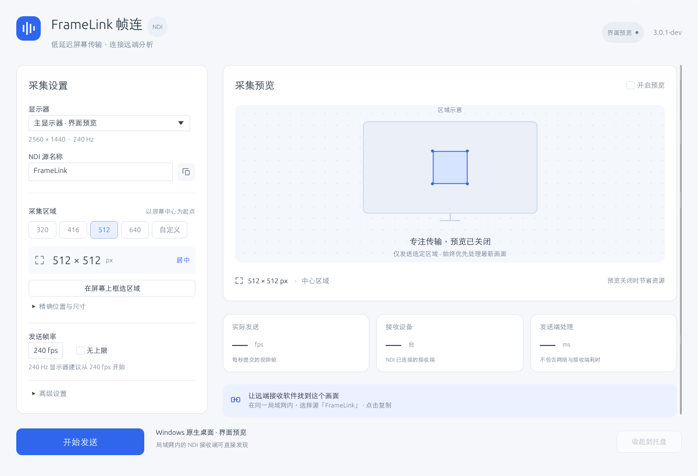
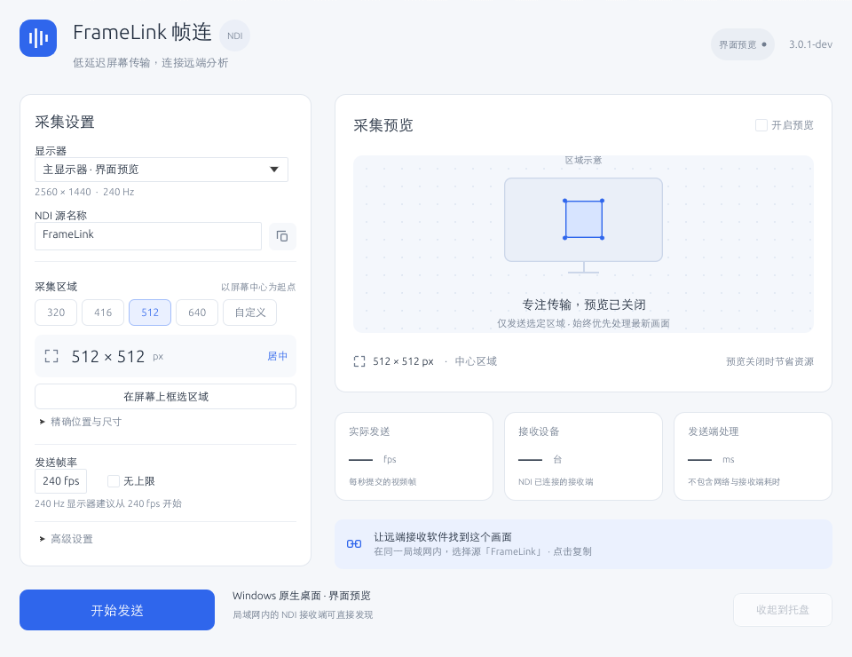

# FrameLink 帧连 · Rust 桌面版 3.0.1-dev

日期：2026-10-21。FrameLink 帧连是原 ScreenCast Send 项目更名后的高性能屏幕推流工具，用于将屏幕区域发送到远程电脑进行分析，AI 识别是其中一个使用场景。当前目标配置包括中心 512×512 / 640×640、240 Hz、两端 8 核 CPU / RTX 4070 Super、千兆局域网，优先让接收端及时拿到新画面。应用主体已迁移为 Rust，并重做原生桌面交互。3.0.1-dev 新增 Windows 单实例与重复启动恢复窗口，采集和传输性能策略没有随此次修改调整。

产品更名不改变 NDI 传输协议、图像格式或接收端发现方式；接收端仍选择 `电脑名 (源名称)`。





这两张图由应用实际 egui 控件树离屏渲染，不是独立设计稿。采集区域是明确标识的示意图；未发送状态下性能值显示“—”，没有填入模拟 FPS、延迟或接收设备数。

## 实现范围

应用代码位于 `rust/`，通过根目录 Cargo 工程构建。Cargo 包与库名为 `framelink`，可执行目标为 `FrameLink`，Windows 文件名为 `FrameLink.exe`，分发包为 `FrameLink-3.0.1-dev-Windows-x64.zip`。不编译或调用旧 `src/` C++ 发送器。原 C++ 源码、原始 EXE 和上一轮包保留作对照。第三方 libyuv 的 SIMD 转换仍是 C/C++，Rust 通过很小的 FFI 边界调用，未将其改成逐像素 Rust 标量循环。

| 模块 | 作用 |
| --- | --- |
| `model.rs` / `settings.rs` | 参数验证、显示器坐标、TOML 保存、旧 Rust TOML / UTF-16 INI 导入 |
| `capture.rs` / `capture/picker.rs` | DXGI 区域采集、GDI、鼠标合成、物理 DPI 坐标、冻结桌面框选 |
| `engine.rs` | 独立发送线程、停止信号、自动恢复、真实统计、预览邮箱 |
| `ndi.rs` / `pixels.rs` | NDI x64 ABI、动态 DLL 生命周期、异步发送缓冲、SIMD 转换 |
| `policy.rs` | 固定帧率截止时间、双缓冲选择、恢复间隔、桌面边界 |
| `ui.rs` / `tray.rs` | 原生 egui 桌面、托盘、异步框选、状态与错误反馈 |
| `single_instance.rs` | Windows 进程生命周期锁、重复启动通知、恢复已有根窗口 |
| `snapshot.rs` | 只用于开发验证的 egui 离屏软件渲染，运行时界面由 OpenGL 渲染 |

NDI DLL 仅在后台启动发送时加载；缺失或接口异常会以内联错误提示反馈，窗口仍可使用。COM、Map、GDI、sender 和 DLL 分别封装生命周期；GPU / NDI 原始指针留在工作线程。GUI 与发送线程只共享小型状态、原子控制开关和一个最新预览。

## 桌面交互改进

- 配置与预览两栏，左侧集中显示器、NDI 源名称、区域和帧率；高级参数折叠。
- 320 / 416 / 512 / 640 中心预设；精确坐标与尺寸；当前区域的比例示意；可在真实桌面框选。
- 开始 / 停止按钮固定在底部。启动、停止、等待恢复在后台完成；框选独立线程运行，Esc / 右键 / 失焦可取消。
- 发送时锁定采集参数，预览可以热切换。关闭 / 最小化暂停预览；托盘收起不停止发送。
- 右侧展示实际提交 fps、已连接接收端和发送端处理合计；说明中明确处理合计不含网络和接收解码。
- 名称可复制；错误直接显示在当前界面，可清除提示并修改参数重试。
- 检查 1200×820 与 960×740 两种真实界面图，修正统计卡片宽度、按钮溢出和高级设置不可见。较小窗口与展开高级参数时可滚动，主操作保留。
- 优先加载 Windows 微软雅黑，开发主机使用现有中文无衬线字体；没有随包复制系统字体。

托盘使用本窗口的原生句柄恢复，避免多个同名窗口时找错实例。托盘建立失败时 X 可走实际退出路径。退出先发停止信号，完成 SDK drain 后关闭；NDI SDK / 显卡驱动自身阻塞时无法由 Rust 立即取消这些外部调用。

### 重复启动

Windows 版使用 Global 命名 mutex 保持进程生命周期内的单实例锁，以自动复位事件通知原实例。锁按整台机器生效，不依赖 EXE 所在路径；窗口只能在原实例所在的交互桌面恢复，不能通过重复启动切换到其他用户会话。窗口通过属性 `FrameLink.SingleInstance.Window.7D57CFC8-11A1-4E8C-91B7-8EE8F5F98D45` 标记，按实际根窗口句柄恢复，不依赖窗口标题查找。重复启动会让已有窗口显示、取消最小化并请求前台激活，然后后启动的进程退出。收到托盘时也恢复同一窗口；不会重建发送器、重载设置或开始第二次发送。

正常退出、启动失败或强制结束都会由操作系统释放锁；下一次启动可以重新取得锁。开发快照参数 `--ui-snapshot` 在单实例入口前处理，可独立生成图片，也不会触发已有实例显示。Windows 前台激活仍受系统焦点规则约束；实际焦点与托盘行为必须在设备上验证。

升级前先退出没有单实例机制的旧版本。旧版既不持有新锁也不监听激活事件，无法参与新版的互斥与恢复。

## 保持的发送性能策略

固定帧率使用 `max(previous + interval, now)`，过载时继续最新采集，不追赶历史时隙。没有新增应用级视频队列；两份像素缓冲和两份稳定描述符交替，重复图像复用原指针而不修改在途像素。异常或正常退出均由 sender 先 flush，再释放像素与描述符，DLL 最后卸载。

NV12 无鼠标路径直接从 mapped BGRA 转换，没有整帧 DIB 中转；BGRA 行距由采集模块实际提供。512 方形区域保持 BT.601，640 方形保持原实现的 BT.709 尺寸规则，超过 1920 / 1080 使用 BT.2020。格式切换需停止后调整。

DXGI 明确暂时错误每秒重试；Auto 固定帧率可暂用 GDI，GDI 同时失败则等待桌面恢复。已进入恢复的 DXGI 暂时无输出可继续等待；有有效显示器且区域已超虚拟桌面边界则停止并提示重选。等待与 Acquire 有限分片检查停止信号。

预览最多 2 fps，最大 320 像素边，只有一个最新图像邮箱。可见时统计界面最多按 10 Hz 主动刷新；隐藏或最小化不持续主动重绘。NDI 自身的编码、网络排队、慢接收端背压和远程分析队列仍可能影响帧龄。

Rust 迁移提供了明确的所有权和模块边界，**不等同于已经证明端到端更快**。本轮没有给出缺乏实测的 1 ms、240 fps 稳定或双机加速比例。

## 配置迁移

新路径是 `%LOCALAPPDATA%\FrameLink\settings.toml`。已有新配置时优先使用它；不存在时优先导入 `%LOCALAPPDATA%\ScreenCastSendRust\settings.toml`，同时兼容原 `%LOCALAPPDATA%\ScreenCastSendCpp\settings.ini`。旧 TOML 与 INI 文件均保留。INI 导入支持 UTF-16 LE 中文源名、原 backend / pixel 数字、负坐标、`lowLatency` 优先于 `precision`、旧 `centerPreset=3` 的 640 和新增 `4` 的 512。

编辑后约 700 ms 保存，写临时文件再替换正式配置；启动和退出也保存。中心预设在启动时按显示器实际边界重新居中；手动改 X / Y / 宽 / 高切到自定义，自定义区域不会在重启时意外恢复为默认中心。

## 验证记录

3.0.1-dev 本轮在 macOS 通过 21 项测试，新增托盘恢复时清除隐藏状态并保留配置的回归用例；原生与 Windows GNU 全目标严格 Clippy 均通过。两个 Windows 命名锁/唤醒事件用例已经编译检查，尚未在 Windows 执行。随包的单实例交互验收脚本也尚未运行。

以下是 Rust 迁移阶段已有的本机验证记录；产品更名后的重新构建与测试以当前交付记录为准：

- `cargo test --locked --lib`：此前 20 项通过，覆盖 NDI x64 ABI / 字段偏移、双槽在途规则、帧率迟到调度、恢复与显示器边界、BGRA padding 拷贝、预览通道 / 单邮箱、颜色矩阵选择、参数和 UTF-16 旧配置、自定义区域重启。
- `cargo check --locked --target x86_64-pc-windows-gnu --all-targets`：Windows 采集、托盘、UI 及测试代码编译检查通过。
- Windows GNU Release 交叉构建已生成 Windows GUI x64 EXE，链接已有 libyuv，未依赖旧 C++ 应用。当前品牌的构建目标使用 `--bin FrameLink`，完整命令见 README。
- 实际 egui 布局离屏渲染并逐图检查，快照不采集桌面、不启动 NDI、不保存用户设置。
- 对异步内存、描述符和异常析构顺序进行独立源码复核。

Windows 实机没有接入本环境。因此托盘事件、框选鼠标与 DPI、多显示器切换、D3D11 映射、NDI 实际发流、稳定 240 fps、全屏 / 锁屏恢复和真实双机分析延迟尚未运行验收。没有将本机纯逻辑测试或交叉编译称为这些场景已经通过。MSVC 构建路径已配置，迁移阶段实际执行的是 MinGW GNU 交叉构建。

3.0.1-dev 新增 `tests/SingleInstanceVerification.ps1`，用于 Windows 实机自动验证重复启动与窗口恢复。此处没有运行该脚本；其覆盖项是待验收场景，不是已经通过的运行记录。

原 `tests/UiVerification.ps1` 和 `RunBenchmarks.ps1` 基于旧 C++ Win32 控件 ID，不能直接验证 egui；历史延迟文档的数字也不代表 Rust 版。

## Windows 验收步骤

1. 解压 `FrameLink-3.0.1-dev-Windows-x64.zip`，启动 `FrameLink.exe`。确认旧 Rust TOML 优先导入、原 C++ INI 仍可导入、旧文件保留、未自动发送，以及 512 / 640 切换与重启保存正确。
2. 固定 240 fps、DXGI、关闭鼠标和预览，分别用 NV12 / BGRX 发同一运动画面给远程分析机器。记录实际接收 fps、CPU、网卡发送率和分析时的帧龄。
3. 打开 / 关闭预览，最小化、收托盘、恢复、停止和重启；确认发送与停止的实际行为。
4. 在缩放显示器和负坐标副屏上框选；切换应用全屏或显示模式，检查自动恢复与区域越界错误。
5. 使用相同测量起止点比较 C++ / Rust。跨机器时间戳相减需校时；识别后点击回传测得的是完整控制回路，不能当作单向视频延迟。
6. 开始实际发送后，分别在正常显示、最小化、收到托盘时再次双击程序或快捷方式。确认恢复原窗口和同一 PID，接收端持续收到画面，源名称、区域、帧率和发送状态未改变；停止后重复验证不会自动开始发送。

单实例自动验证命令：

```powershell
powershell -ExecutionPolicy Bypass -File tests/SingleInstanceVerification.ps1 -Executable .\dist\FrameLink-3.0.1-dev-Windows-x64\FrameLink.exe
```

脚本随包放在 `tests/` 中，在解压目录运行时可省略 `-Executable`；默认先找同级 `FrameLink.exe`，再找源码目录下的本版发布包。脚本要求先退出同路径实例，也拒绝已发现带上述窗口标记或机器级 mutex 的其他实例，以免干扰已有会话。覆盖正常窗口、最小化、关闭到托盘后再次启动、并发启动仅保留原 PID，以及强制结束后并发重新启动。配置中 `close_to_tray = false` 时明确跳过关闭到托盘测试，不改设置。脚本只结束它自己创建的进程，不自动开始推流，也不测试正在推流的接收连续性；运行期间不要手动操作窗口或另外启动程序。

## 依赖参考

桌面 API 以锁定版本的 [eframe 官方源码](https://github.com/emilk/egui/tree/main/crates/eframe)、[tray-icon 官方源码](https://github.com/tauri-apps/tray-icon) 与本机 Cargo 缓存为依据。采集使用 [Microsoft Desktop Duplication API](https://learn.microsoft.com/en-us/windows/win32/direct3ddxgi/desktop-dup-api)，异步缓冲的归还边界参照 [NDI-SEND](https://docs.ndi.video/all/developing-with-ndi/sdk/ndi-send)。依赖版本记录在 `Cargo.lock`，包内包含原许可证及依赖声明。
